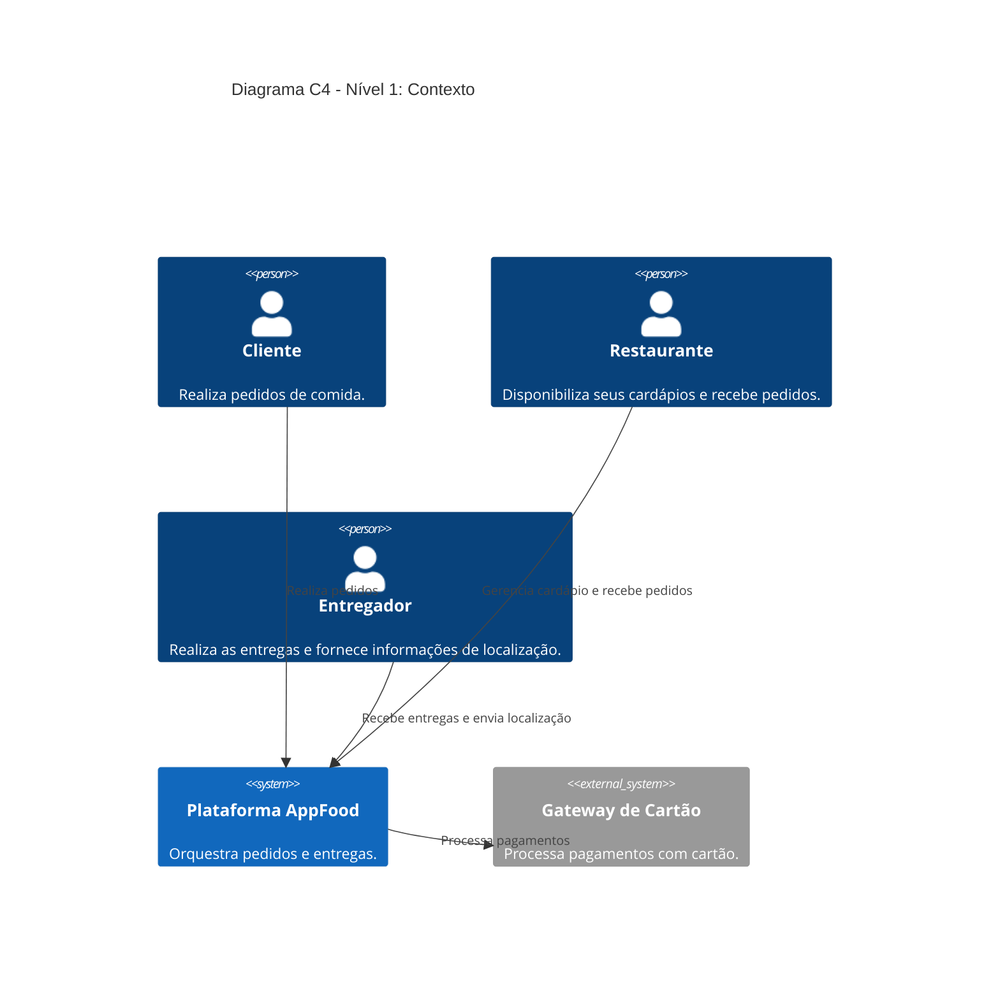
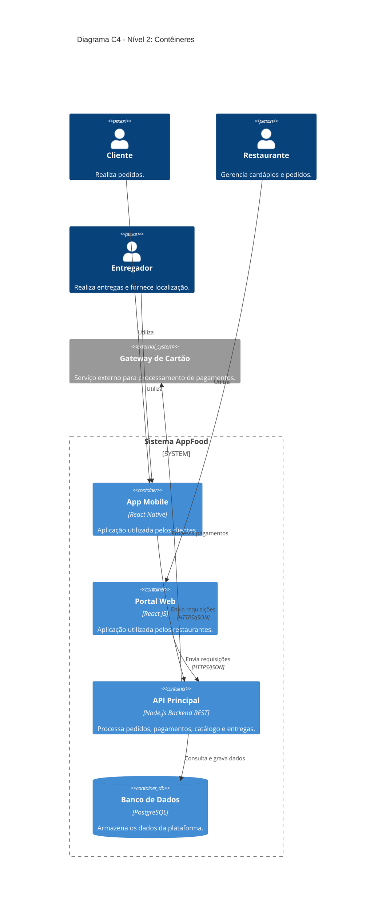
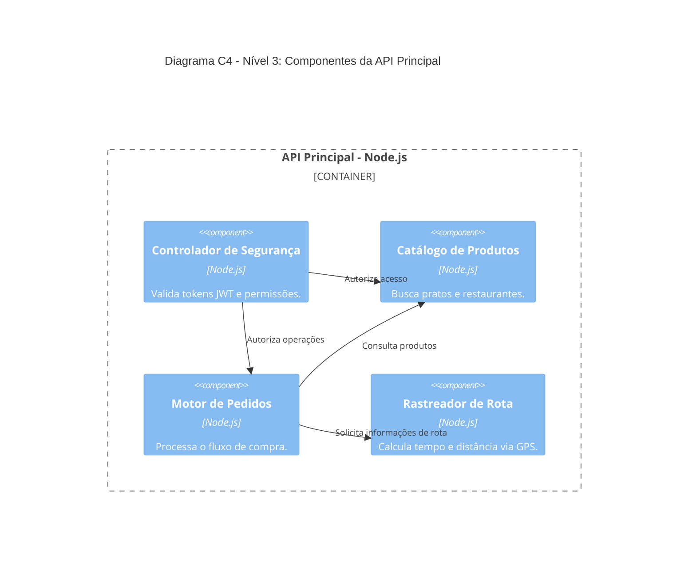
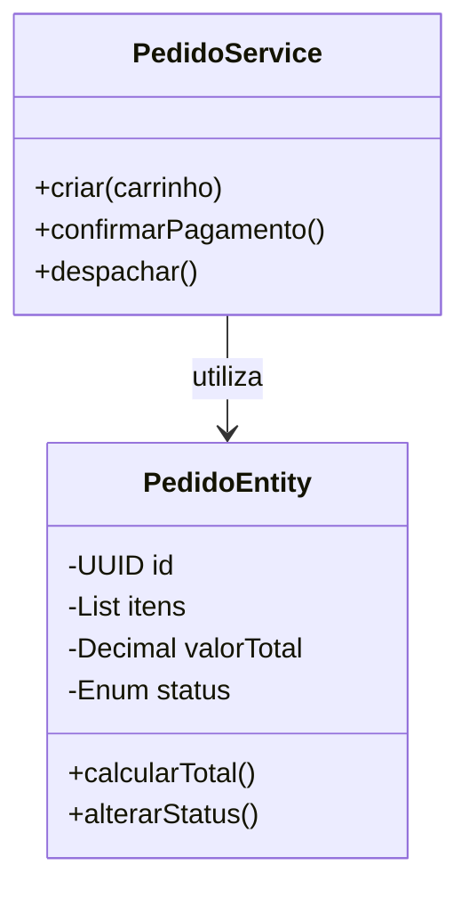

# Atividade Prática — Construindo o Modelo C4

## Sistema: AppFood Delivery

O **AppFood Delivery** é uma plataforma de intermediação logística e comercial. O sistema conecta clientes, restaurantes e entregadores, além de integrar os cardápios dos restaurantes e permitir o rastreamento das frotas de entregadores.

---

# Nível 1: Contexto

O primeiro nível apresenta uma visão geral do sistema, mostrando quem utiliza a plataforma e quais sistemas externos possuem relação com ela.

### Elementos

- **Cliente:** utiliza a plataforma para realizar pedidos.
- **Restaurante:** utiliza a plataforma para disponibilizar e administrar seus produtos/cardápios.
- **Entregador:** utiliza a plataforma para receber informações de entrega e localização.
- **Gateway de Cartão:** serviço externo utilizado para realizar o processamento dos pagamentos.
- **Plataforma AppFood:** sistema responsável por orquestrar os pedidos e as entregas.

### Diagrama

---

# Nível 2: Contêineres

O segundo nível apresenta as principais aplicações executáveis e o armazenamento de dados que fazem parte do sistema AppFood.

### Contêineres

- **App Mobile:** aplicação utilizada pelo cliente, desenvolvida em React Native.
- **Portal Web:** aplicação utilizada pelos restaurantes, desenvolvida em React JS.
- **API Principal:** backend responsável pelas regras e processamento do sistema, utilizando Node.js e REST.
- **Banco de Dados:** responsável pelo armazenamento das informações, utilizando PostgreSQL.

### Diagrama

---

# Nível 3: Componentes

O terceiro nível detalha os módulos internos da **API Principal**, mostrando a divisão das responsabilidades dentro do backend.

### Componentes

- **Controlador de Segurança:** valida tokens JWT e permissões.
- **Catálogo de Produtos:** realiza buscas de pratos e restaurantes.
- **Motor de Pedidos:** processa o fluxo de compra.
- **Rastreador de Rota:** calcula tempo e distância utilizando GPS.

### Diagrama

---

# Nível 4: Código

O quarto nível apresenta um detalhamento da implementação do **Motor de Pedidos**, utilizando uma representação semelhante a um diagrama de classes UML.

## Classe PedidoService

A classe `PedidoService` possui operações responsáveis pelo fluxo do pedido:

- `criar(carrinho)`
- `confirmarPagamento()`
- `despachar()`

## Classe PedidoEntity

A classe `PedidoEntity` representa os dados de um pedido.

### Atributos

- `id: UUID`
- `itens: List`
- `valorTotal: Decimal`
- `status: Enum`

### Métodos

- `calcularTotal()`
- `alterarStatus()`

### Diagrama UML

---

# Conclusão

O modelo C4 permite representar o sistema em diferentes níveis de detalhamento.

No **Nível 1**, temos uma visão geral do sistema e dos usuários e serviços externos relacionados.

No **Nível 2**, são apresentados os principais contêineres da plataforma, como o aplicativo mobile, o portal web, a API principal e o banco de dados.

No **Nível 3**, a API Principal é dividida em componentes internos, como segurança, catálogo, pedidos e rastreamento de rota.

Por fim, no **Nível 4**, é apresentado um exemplo de implementação do Motor de Pedidos por meio das classes `PedidoService` e `PedidoEntity`.

Dessa forma, o C4 ajuda a organizar a arquitetura desde a visão de negócio até os detalhes do código, facilitando a comunicação e o entendimento do sistema.
