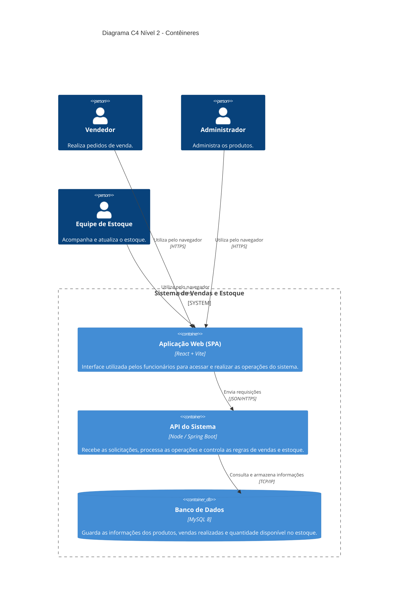

# Diagrama C4 Nível 2 (Contêineres)

Detalhamento da estrutura interna do sistema, separando a aplicação em uma interface web, uma API responsável pelo processamento e um banco de dados para armazenar as informações.

